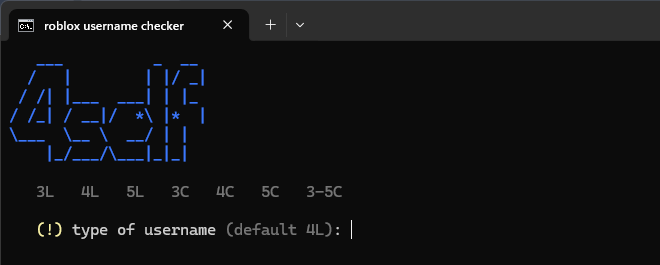
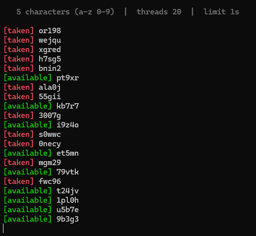

# roblox-username-checker

Checks roblox usernames and prints the result in the terminal:
taken names in red, free names in green. Every free name is saved to `available.txt`.

## usage

1. install **python 3.8+** - tick `Add python.exe to PATH` in the installer
2. run **`run.bat`**
3. type what you want to check, press enter for the default `4L`
4. free names are written to **`available.txt`**

Missing libraries (`aiohttp`, `colorama`) are installed on the first start.
Nothing is installed when they are already there.

Example output:

## types

Type a length and the kind of name you want - `L` for letters, `C` for
characters (letters and numbers). Nothing entered means `4L`.

| type | checks |
|------|--------|
| `4L` | 4 letter usernames (default) |
| `3L` `5L` | 3 or 5 letter usernames |
| `3C` `4C` | 3 or 4 character usernames, letters and numbers |
| `3-5C` | 3, 4 and 5 character usernames |
| `3,5L` | 3 and 5 letter usernames |

Any length from 3 to 20 works.

## notes

- 20 parallel requests, 1 second limit per request
- colours: red = taken, green = available, yellow = rate limit, grey = error
- after you pick a type the prompt disappears and only the log is shown
- runs until it runs out of usernames - `ctrl+c` stops it at any time
- nothing is created on roblox, the checker only asks if a name is free
- free names are appended to `available.txt`, so you can continue later

Not affiliated with roblox. For personal use.
